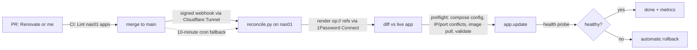

<div align="center">


###  Home Operations Repository 

_Self-hosted apps on TrueNAS SCALE &middot; GitOps-reconciled Docker Compose &middot; Renovate + CI gated_ 

<br/>

<picture>
  <source media="(prefers-color-scheme: dark)" srcset="https://kromgo-proxy.pixel-forge.workers.dev/stack_panel?theme=dark">
  <source media="(prefers-color-scheme: light)" srcset="https://kromgo-proxy.pixel-forge.workers.dev/stack_panel?theme=light">
  
</picture>
<br/>
<picture>
  <source media="(prefers-color-scheme: dark)" srcset="https://kromgo-proxy.pixel-forge.workers.dev/health_panel?theme=dark">
  <source media="(prefers-color-scheme: light)" srcset="https://kromgo-proxy.pixel-forge.workers.dev/health_panel?theme=light">
  
</picture>
<br/>
<picture>
  <source media="(prefers-color-scheme: dark)" srcset="https://kromgo-proxy.pixel-forge.workers.dev/usage_panel?theme=dark">
  <source media="(prefers-color-scheme: light)" srcset="https://kromgo-proxy.pixel-forge.workers.dev/usage_panel?theme=light">
  
</picture>
<br/>
<picture>
  <source media="(prefers-color-scheme: dark)" srcset="https://kromgo-proxy.pixel-forge.workers.dev/gitops_panel?theme=dark">
  <source media="(prefers-color-scheme: light)" srcset="https://kromgo-proxy.pixel-forge.workers.dev/gitops_panel?theme=light">
  
</picture>
<br/>
<picture>
  <source media="(prefers-color-scheme: dark)" srcset="https://kromgo-proxy.pixel-forge.workers.dev/network_status?theme=dark">
  <source media="(prefers-color-scheme: light)" srcset="https://kromgo-proxy.pixel-forge.workers.dev/network_status?theme=light">
  
</picture>

</div>

---

##  Overview

This repository is the source of truth for my homelab's self-hosted applications. Every app runs as a
**TrueNAS SCALE custom app** (Docker Compose) on `nas01` and is deployed by a small GitOps reconciler that lives in
this repo: merging to `main` is deploying. [Renovate](https://github.com/renovatebot/renovate) keeps every image
pinned and current, and [GitHub Actions](https://github.com/features/actions) gate each deploy.

**History:** the apps used to run on a 3-node Kubernetes cluster (Fedora CoreOS + kubeadm, Flux, Cilium,
kgateway, scale-csi NVMe-oF storage). That cluster was retired on 2026-11-14 after every app moved to nas01. The
[`kubernetes/`](./kubernetes/) tree and the [`homeops-cli`](./cmd/homeops-cli) tooling are **kept intact but
parked** so the cluster can be rebuilt later — see [Kubernetes (parked)](#-kubernetes-parked).

---

##  How deploys work

```
truenas/
├── apps/<app>/
│   ├── compose.yaml   # the full compose TrueNAS runs; secrets are {{ op://... }} references
│   ├── app.yaml       # optional: dirs, templated files, ini pins, health probe, deploy order
│   └── *.tmpl         # optional: config templates rendered to host paths
├── networks.yaml      # shared Docker networks
└── reconciler/        # reconcile.py (runs on nas01) + lint.py (CI) + tests
```



- **CI-gated:** only commits whose `truenas/` changes passed the *Lint nas01 apps* check deploy; a red or pending
  check holds nas01 on the last good commit (it never rewinds).
- **Drift-correcting:** edits made in the TrueNAS UI are logged as drift (+ metric) and re-applied from git.
- **Safe by default:** nothing running is touched unless preflight passes; failed deploys roll back to the exact
  previous compose; critical apps (1Password Connect, Pocket ID, Envoy) deploy last, one at a time.
- **No secrets in git:** the repo is public; secrets and the domain are `op://` references resolved on nas01.

Full details: [`truenas/README.md`](./truenas/README.md).

---

##  Applications

38 apps. Every web UI sits behind Envoy with TLS and Pocket ID single sign-on (passkeys/OIDC).

| Group | Apps |
|-------|------|
| **Media** | [Jellyfin](https://github.com/jellyfin/jellyfin) (NVIDIA T600 transcoding), [Seerr](https://github.com/seerr-team/seerr), [Audiobookshelf](https://github.com/advplyr/audiobookshelf), Grimmory, [Pinchflat](https://github.com/kieraneglin/pinchflat) |
| **Downloads** | [Sonarr](https://github.com/Sonarr/Sonarr) (+ Recyclarr), [Radarr](https://github.com/Radarr/Radarr), Chaptarr, [Bazarr](https://github.com/morpheus65535/bazarr), [Prowlarr](https://github.com/Prowlarr/Prowlarr), [Autobrr](https://github.com/autobrr/autobrr), [NZBGet](https://github.com/nzbgetcom/nzbget), [qBittorrent](https://github.com/qbittorrent/qBittorrent) (VPN-only egress via gluetun), [qui](https://github.com/autobrr/qui) |
| **Home & productivity** | [Home Assistant](https://github.com/home-assistant/core), [n8n](https://github.com/n8n-io/n8n), [Actual](https://github.com/actualbudget/actual), [FreshRSS](https://github.com/FreshRSS/FreshRSS), [Atuin](https://github.com/atuinsh/atuin), [IT-Tools](https://github.com/CorentinTh/it-tools), [webhook](https://github.com/adnanh/webhook) |
| **Platform** | [Envoy](https://github.com/envoyproxy/envoy) (HTTPS ingress + native OAuth2), [cloudflared](https://github.com/cloudflare/cloudflared) (public hostnames), [Pocket ID](https://github.com/pocket-id/pocket-id) (SSO), [1Password Connect](https://developer.1password.com/docs/connect/) (secrets for the reconciler), [SeaweedFS](https://github.com/seaweedfs/seaweedfs) (S3), GitHub runners (ephemeral, for infrastructure-automation) |
| **Observability** | [VictoriaMetrics](https://github.com/VictoriaMetrics/VictoriaMetrics), vmalert, [Alertmanager](https://github.com/prometheus/alertmanager) (→ Pushover), [Grafana](https://github.com/grafana/grafana), [Blackbox Exporter](https://github.com/prometheus/blackbox_exporter), [Gatus](https://github.com/TwiN/gatus), [kromgo](https://github.com/kashalls/kromgo) (the badges above), node-exporter, [cAdvisor](https://github.com/google/cadvisor), [Scrutiny](https://github.com/AnalogJ/scrutiny), smartctl-exporter |

### Observability

VictoriaMetrics on nas01 scrapes nas01, the Proxmox host and VMs, DNS/DHCP, the network devices and the WAN
monitors (fiber edge + cellular backup). vmalert evaluates the alert rules in
[`truenas/apps/vmalert`](./truenas/apps/vmalert) and Alertmanager routes them to Pushover with a Watchdog
heartbeat. The reconciler exports its own `truenas_apps_gitops_*` metrics, so a stuck or failing deploy alerts too.

---

##  Networking & access

- **Internet edge:** UniFi UXG-Fiber on Frontier 5 Gbit/s symmetric fiber, eBGP to the core switch. An Alta
  Route10 on T-Mobile 5G is the cellular backup; its default route only wins when the fiber default is withdrawn.
  IPv4 only.
- **Core:** Cisco Catalyst 9300 is the L3 gateway for every VLAN, with TrustSec (SGT/SGACL) segmentation.
- **Ingress:** Envoy on nas01 terminates TLS for every app and does OAuth2 against Pocket ID. Public hostnames
  arrive through a Cloudflare Tunnel; everything else is LAN or Cloudflare Zero Trust (WARP) only.
- **DNS:** PowerDNS authoritative + recursor on two RHEL VMs (anycast VIP via BGP), filtered upstream through
  Cloudflare Gateway; Kea DHCP in HA.

---

##  Storage & backups

- **Pool:** `flashstor`, 28.5 TB usable — 3x RAIDZ1 vdevs with a mirrored NVMe SLOG and NVMe L2ARC.
- **App data:** one dataset per app under `/mnt/flashstor/apps/<app>-*`, used locally by the containers. nas01
  exports nothing over NFS, SMB, iSCSI or NVMe-oF any more.
- **Snapshots:** recursive `flashstor` snapshots daily (kept 2 weeks); SeaweedFS snapshots hourly (kept 48 h).
- **Backups:** SeaweedFS (S3) is ZFS-replicated to a separate `backup` pool and synced off-site to Google Drive.

---

##  CI & automation

| Workflow | What it does |
|----------|--------------|
| `truenas-apps` (**Lint nas01 apps**) | Compose lint + reconciler unit tests; the check the reconciler waits for before deploying |
| `renovate` | Renovate (docker-compose manager): digest/patch bumps auto-merge, minor/major need review |
| `go`, `release`, `tag` | Build, test and release `homeops-cli` |
| `labeler`, `label-sync` | PR labels |
| `flux-local`, `image-pull`, `flux-reconcile`, `schemas` | Kubernetes-only; they run only when `kubernetes/**` changes, which it no longer does |

Renovate ignores `kubernetes/**`, so the parked manifests stay exactly as they were.

---

##  Kubernetes (parked)

The cluster this repo was built around is retired, but nothing was deleted from git:

- [`kubernetes/`](./kubernetes/) — the full Flux tree (apps, components, Flux config) as it was at retirement.
- [`cmd/homeops-cli`](./cmd/homeops-cli) — the custom Go CLI (~25,000 lines) that provisioned Fedora CoreOS
  VMs on Proxmox (Butane → Ignition via fw_cfg), bootstrapped kubeadm (`init`/`join` over SSH, then Cilium, CRDs
  and Flux) and handled node lifecycle (`cluster replace-node`, `rehearse-node`). See its
  [README](./cmd/homeops-cli/README.md).

The retired stack was Fedora CoreOS 44 + kubeadm (Kubernetes v1.36) on three Proxmox VMs, Cilium (eBPF, BGP to
the core switch), kgateway (Gateway API), cert-manager with Google Trust Services, external-secrets with
1Password, and [scale-csi](https://github.com/GizmoTickler/scale-csi) — a purpose-built TrueNAS CSI driver
(NVMe-oF/TCP, iSCSI, NFS) — with [kopiur](https://github.com/home-operations/kopiur) for PVC backups. Rebuilding
it would also need new storage plumbing: the NVMe-oF fabric to TrueNAS was retired with the cluster.

---

##  Cloud Dependencies

Most things are self-hosted, but a few critical services stay in the cloud to avoid chicken-and-egg problems.

| Service                                         | Use                                                               | Cost           |
|-------------------------------------------------|-------------------------------------------------------------------|----------------|
| [1Password](https://1password.com/)             | Secrets (resolved on nas01 through 1Password Connect)             | ~$65/yr        |
| [Cloudflare](https://www.cloudflare.com/)       | Domain, DNS, tunnel and Zero Trust                                | ~$30/yr        |
| [Google Workspace](https://workspace.google.com/) | Email hosting and productivity suite                            | ~$72/yr        |
| [GitHub](https://github.com/)                   | Repository hosting and CI/CD with Actions                         | Free           |
| [iLert](https://www.ilert.com/)                 | Incident management and alerting                                  | Free (tier)    |
| [Pushover](https://pushover.net/)               | Mobile notifications for alerts                                   | $5 OTP         |
|                                                 |                                                                   | Total: ~$14/mo |

---

##  Hardware

| Component | Specifications | Role |
|-----------|----------------|------|
| **nas01** — TrueNAS SCALE 27 | 2x Xeon E5-2640 v4, 256 GB ECC, `flashstor` 28.5 TB (3x RAIDZ1 + NVMe SLOG/L2ARC), separate `backup` pool, NVIDIA T600, 4x 10GbE LACP | Every app in this repo, plus a few VMs |
| **pve** — Proxmox VE 9 (HPE DL380 Gen9) | 2x Xeon E5-2697A v4 (32C/64T), 512 GB ECC, `nvme-fast` (2x Intel P3700) + `vm-ssd` mirrors, 3x 10GbE LACP | Infrastructure VMs (UniFi controller, DNS, dev VMs) and a network lab |
| **Core switch** | Cisco Catalyst 9300-24UX | L3 gateway for all VLANs, TrustSec |
| **Internet edge** | UniFi UXG-Fiber | Frontier 5 Gbit/s fiber |
| **Backup WAN** | Alta Route10 + T-Mobile 5G modem | Cellular failover |

Everything sits in a UPS-backed rack in the basement.

---

##  Learning & Credits

This homelab serves as a continuous learning platform for cloud-native technologies, GitOps practices, and infrastructure automation. The setup provides hands-on experience with production-grade tools and practices in a controlled environment.

**Special thanks to [onedr0p](https://github.com/onedr0p)** and the [k8s-at-home](https://github.com/k8s-at-home) community. This repository was heavily inspired by onedr0p's [home-ops](https://github.com/onedr0p/home-ops) repository, which served as an excellent learning resource and foundation for understanding GitOps workflows and Kubernetes cluster management, and still shapes how this repo is run.

---

##  Gratitude and Thanks

Thanks to all the people who donate their time to the [Home Operations](https://discord.gg/home-operations) Discord community. Be sure to check out [kubesearch.dev](https://kubesearch.dev/) for ideas on how to deploy applications or get ideas on what you could deploy.
